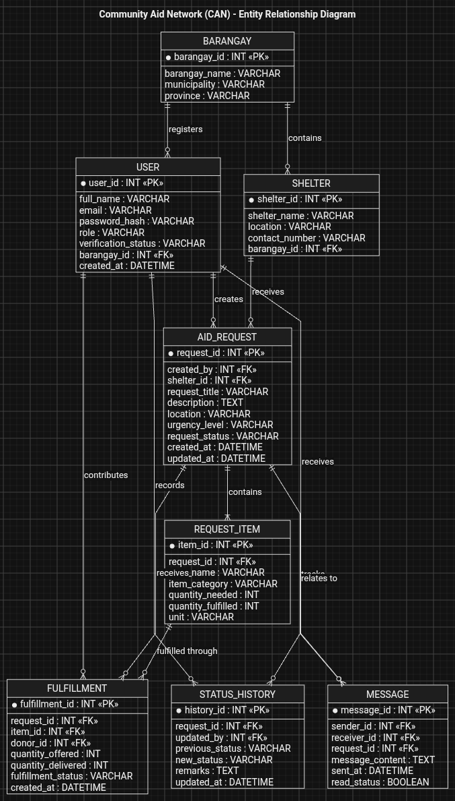

# acezeey | Portfolio

> Computer Engineering Student & Creator building Project Nexus.

## 📌 Overview
Welcome to my portfolio repository! This repository hosts the source code and files for my personal portfolio website (`index.html`), highlighting my background as a student, creative, gamer, and developer exploring innovative workflows, software design, and digital experiences.

## 🚀 Featured Project
### Project Nexus: Community Aid Network (CAN)

* **Description:** A web-based platform designed for disaster response, emergency reporting, and local social support. CAN aims to connect verified community representatives with donors providing essential goods and medical supplies during emergencies.
* **Purpose:** To organize aid requests, improve coordination, and track the fulfillment of community needs without monetary transactions.
* **Status:** In development.

### 📊 Database Design — Entity Relationship Diagram (ERD)

As part of the CAN capstone project, I worked on the proposed database design, outlining the entities, attributes, and relationships needed to support the platform.

* **PlantUML Source:** [View CAN-ERD.puml](projects/projects/community-aid-network/diagrams/projects/community-aid-network/diagrams/CAN-ERD.puml)

## 🛠️ Built With
* HTML5 / CSS3
* Responsive modern dark-theme layout
* PlantUML for ERD source documentation

## 📬 Contact & Connect
* **GitHub:** [github.com/acezeey](https://github.com/acezeey)
* **Gmail:** acezeey39@gmail.com
